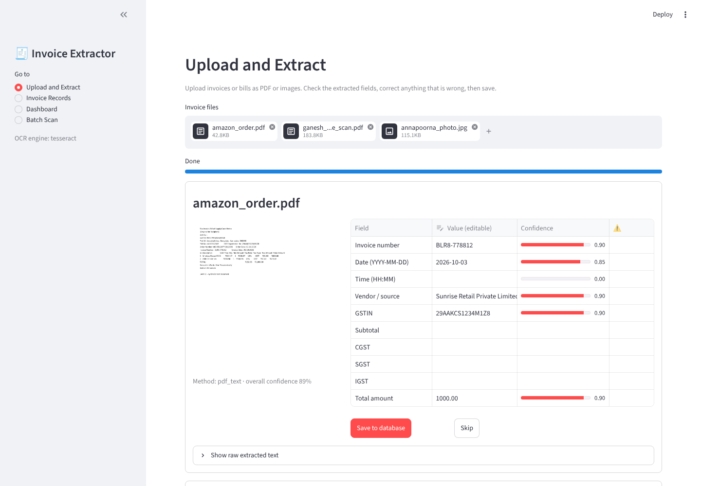
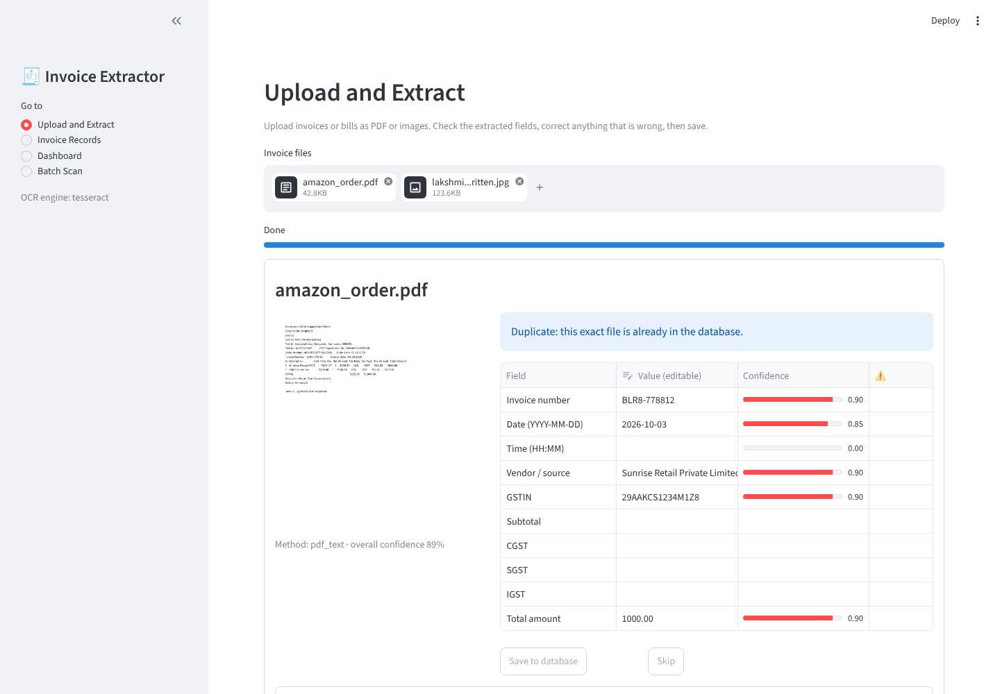
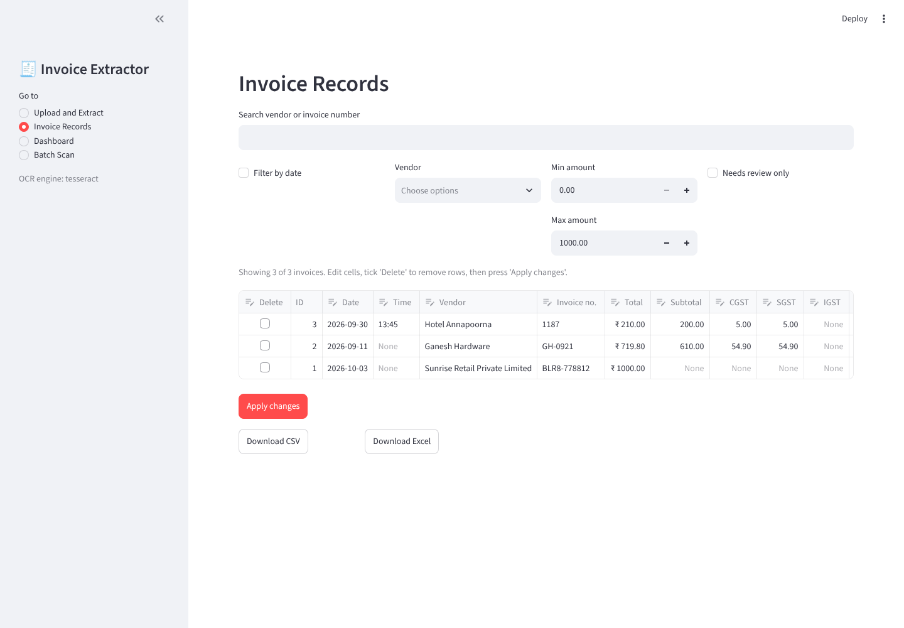
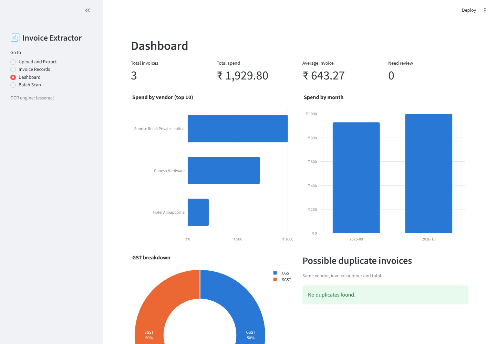
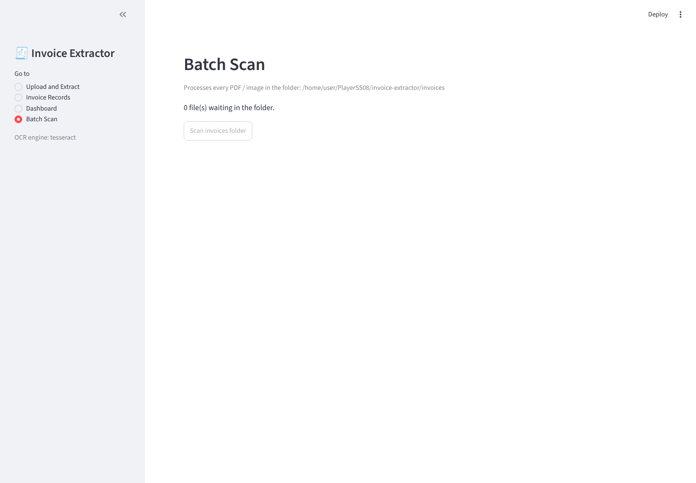

# 🧾 Invoice Extractor

A Python application that reads invoices and bills stored as **PDF files or images** and
automatically extracts the **date, time, vendor (source), invoice number and total amount**,
plus GST details and a confidence score for every field. It handles digital PDFs, scanned
PDFs and phone photos of bills (via OCR), validates GST arithmetic, flags uncertain results for
review, stores everything in **SQLite**, lets you correct and export the records to **CSV/Excel**,
and shows a spending dashboard by vendor and month. The whole project is **Python only**: the
user interface is built with Streamlit, so there are no HTML, CSS or JavaScript files.

---

## 1. Problem statement

Businesses and individuals receive invoices and bills as scanned PDFs, photos and digital
documents, and entering their details by hand is slow and error-prone. This project builds a
Python application that accepts invoices in PDF or image format, extracts the invoice date,
time, vendor, invoice number and total amount using text extraction, OCR and rule-based
parsing, validates GST calculations, and stores the results in a SQLite database. Users can
review and correct low-confidence fields, export records to CSV or Excel, and view spending
summaries by vendor and month. The system reports its extraction accuracy on a test set of
invoices.

## 2. Features

- **Upload many files at once** (PDF, JPG, JPEG, PNG) with a progress bar and a preview of each file
- **Three extraction paths**: digital PDF text (`pymupdf`, with `pdfplumber` as backup) → scanned PDF
  (pages rendered at 300 DPI, then OCR) → images (OCR)
- **Image cleaning before OCR**: grayscale, upscale, denoise, deskew, adaptive threshold;
  Tesseract runs with `--psm 6` and `--psm 4` and the more confident result is kept
- **Fields extracted**: invoice number, date, time, vendor, GSTIN, subtotal, CGST, SGST, IGST, total
- **Indian formats**: day-first dates (`31/10/26`, `31-Oct-2026`, …), `₹ / Rs. / INR`, lakh grouping
  (`1,23,456.78`), `500/-`, common OCR mistakes (`O→0`, `l→1`, `S→5` inside numbers)
- **Confidence score per field** plus an overall weighted score; low-confidence fields get a ⚠️
- **Validation**: GST arithmetic check (±₹1), GSTIN structure + state code, sanity checks
  (total > 0 and < ₹1 crore, date not in the future), automatic **needs-review** flag
- **Editable results**: fix any field before saving; corrected fields are marked as verified
- **Duplicate detection**: the same file (SHA-256 hash) is never imported twice; same
  vendor + invoice number gives a warning; the dashboard lists vendor + number + total matches
- **Records page**: search, filter by date / vendor / amount / needs-review, edit, delete,
  download **CSV** or **Excel**
- **Dashboard**: total invoices, total spend, average invoice, number needing review, spend by
  vendor (top 10), spend by month, GST breakdown, possible duplicates
- **Batch scan** of the `invoices/` folder (from the app or the command line)
- **Never crashes on a bad file**: unreadable files are saved with `needs_review` and a warning;
  if no OCR engine is installed the app says so clearly and still processes digital PDFs

## 3. Screenshots

| Page | Screenshot |
|---|---|
| 1. Upload and Extract |  |
| 1. Duplicate + needs-review messages |  |
| 2. Invoice Records |  |
| 3. Dashboard |  |
| 4. Batch Scan |  |

## 4. Architecture

```
            ┌──────────────┐     ┌───────────────────────────┐
 PDF/image ─▶ text_extraction│──▶ │ digital PDF? → pdf_text     │
            │ get_text()   │     │ scanned PDF  → ocr.py (300 DPI)
            └──────────────┘     │ image        → ocr.py       │
                   │              └───────────────────────────┘
                   ▼  raw text
            ┌──────────────┐   normalise text, one function per field
            │  parser.py   │──▶ fields.py  (number, date, time, vendor, total, GST)
            └──────────────┘
                   │  InvoiceData (models.py)
                   ▼
            ┌──────────────┐   GST check, GSTIN check, sanity checks,
            │ validators.py│   confidence, needs_review
            └──────────────┘
                   │
                   ▼
   app.py (Streamlit) ──▶ storage/db.py (SQLite) ──▶ storage/export.py (CSV / Excel)
                                   │
                                   └──▶ analytics/dashboard.py (Plotly charts)
```

```
invoice-extractor/
├── app.py                      # Streamlit UI (entry point)
├── config.py                   # constants: paths, thresholds, OCR engine
├── extractor/
│   ├── text_extraction.py      # get_text(file) -> (text, method), file hashing
│   ├── ocr.py                  # preprocess_image(), ocr_image(), scanned PDFs
│   ├── parser.py               # parse_invoice(text) -> InvoiceData, process_file()
│   ├── fields.py               # one function per field (date, time, amount, vendor, ...)
│   ├── validators.py           # GST check, sanity checks, confidence scoring
│   ├── models.py               # InvoiceData dataclass
│   └── vendors.json            # known vendor names (easy to extend)
├── storage/
│   ├── db.py                   # connect, init_db, insert, update, delete, query, filter
│   └── export.py               # to_csv(), to_excel()
├── analytics/
│   └── dashboard.py            # spend_by_vendor(), spend_by_month() + Plotly figures
├── scripts/
│   ├── scan_folder.py          # batch CLI (descendant of the old Scanner.py)
│   └── evaluate.py             # accuracy report against tests/ground_truth.csv
├── tests/                      # pytest suite (193 tests)
│   ├── samples/                # 18 sample invoices + make_samples.py
│   └── ground_truth.csv        # expected values for each sample
├── docs/screenshots/           # screenshots used in this README
├── data/                       # invoices.db is created here (gitignored)
├── invoices/                   # drop-in folder for batch scan (gitignored)
└── requirements.txt
```

### What happened to the original `Scanner.py`

Its logic was **moved and extended, not deleted**:

| Old `Scanner.py` | Now |
|---|---|
| Invoice-number regex | `extractor/fields.py` → `extract_invoice_number()` with more labels (Inv No, Bill No, Receipt No, Order ID, …) |
| `pymupdf` text reading | `extractor/text_extraction.py` → `pdf_text_pymupdf()` |
| `INSERT OR IGNORE` de-duplication | `storage/db.py` → `insert_invoice()`, now keyed on the **file hash** so two vendors can both have invoice `0001` |
| `date_added` (scan time) | renamed `scanned_at`; the date printed on the invoice is the new `invoice_date` |
| `Manager` database file | `data/invoices.db` |
| DB connection + folder creation at import time | `get_connection()` / `connect()` context manager, created only when needed |
| `print` instead of returning data | functions return data; printing only in the CLI script |
| "REVIEW" message & skip | file is **saved** and flagged `needs_review` |
| `scan_invoices()` / `show_database()` | `scripts/scan_folder.py` (PDFs **and** images) and the Batch Scan page |

## 5. Installation

Requires **Python 3.10+** (tested on 3.13) on Windows, macOS or Linux.

```bash
cd invoice-extractor
```

```bash
python -m venv .venv
```

Activate it: `.venv\Scripts\activate` (Windows) or `source .venv/bin/activate` (macOS/Linux), then:

```bash
pip install -r requirements.txt
```

### Install Tesseract (needed for images and scanned PDFs)

`pytesseract` is only a Python wrapper; the Tesseract program itself must be installed:

| OS | Command |
|---|---|
| Windows | Download the installer from [UB Mannheim](https://github.com/UB-Mannheim/tesseract/wiki) and tick "Add to PATH" (or add `C:\Program Files\Tesseract-OCR` to PATH) |
| macOS | `brew install tesseract` |
| Linux (Debian/Ubuntu) | `sudo apt install tesseract-ocr` |

Check it with `tesseract --version`. Without Tesseract the app still works for **digital PDFs** and
shows a clear message for images. Optional alternative: `pip install easyocr` and set
`OCR_ENGINE = "easyocr"` in `config.py`.

## 6. How to run

```bash
streamlit run app.py
```

The browser opens at <http://localhost:8501>. Use the sidebar to switch between
**Upload and Extract**, **Invoice Records**, **Dashboard** and **Batch Scan**.

Batch scan from the command line (put files in `invoices/` first):

```bash
python scripts/scan_folder.py
```

Run the tests:

```bash
python -m pytest
```

Run the accuracy report (add `--details` to list every mismatch):

```bash
python scripts/evaluate.py
```

Regenerate the sample invoices and `ground_truth.csv`:

```bash
python tests/samples/make_samples.py
```

## 7. Accuracy results

Output of `python scripts/evaluate.py` on the 18 files in `tests/samples/`:

| Field | Correct / Total | Accuracy |
|---|---|---|
| invoice_number (only where present) | 17 / 17 | 100.0% |
| invoice_date | 17 / 18 | 94.4% |
| invoice_time (only where present) | 8 / 8 | 100.0% |
| vendor | 17 / 18 | 94.4% |
| total_amount | 18 / 18 | 100.0% |

Matching rules: amounts within ₹0.01, dates/times compared as ISO strings, vendor matched
case-insensitively as a substring. Both misses are on the handwritten-style bill (OCR drops
the date line and reads "Lakshmi" as "Lakshmj"); that bill is correctly flagged *needs review*.

**Be honest about these numbers in the viva:** the current sample set is **synthetic**
(generated by `tests/samples/make_samples.py` with fictional names and numbers, no personal
data). It covers every type the spec asks for (Amazon/Flipkart-style invoices, Swiggy/Zomato
orders, electricity and phone bills, restaurant/café/fuel receipts, phone photos with tilt,
shadow and noise, scanned PDFs and a handwritten-style bill) but it is cleaner than real
documents. **Before the final presentation, add your own real invoices** to `tests/samples/`
(blur phone numbers, addresses and card digits first), add one row per file to
`tests/ground_truth.csv`, re-run `evaluate.py` and update this table.

## 8. Limitations and future work

- **Handwritten bills** are unreliable with Tesseract; a handwriting OCR model (e.g. TrOCR) would help.
- **English only**; Hindi/regional-language invoices need extra Tesseract language packs and keywords.
- **Rule-based parsing** depends on labels such as "Grand Total"; unusual layouts fall back to
  guesses (flagged for review). A layout-aware ML model (LayoutLM, Donut) could learn layouts.
- Marketplace invoices list the **seller** (e.g. "Sold By") as the vendor, not the marketplace.
- Totals from tables without a summary line, and multi-currency invoices, are not handled.
- Future: line-item extraction, category tagging (food, travel, utilities), user login,
  monthly PDF summaries.

## 9. Team members and task allocation

*(Replace "Person 1–4" with your names. Everyone must have their own commits on GitHub.)*

| Member | Responsibility | Main files |
|---|---|---|
| Person 1 | PDF text extraction, batch script, file hashing | `text_extraction.py`, `scripts/scan_folder.py` |
| Person 2 | OCR and image preprocessing | `ocr.py` |
| Person 3 | Field parsing, validators, tests, accuracy evaluation | `fields.py`, `parser.py`, `validators.py`, `tests/`, `evaluate.py` |
| Person 4 | Streamlit UI, database, export, dashboard | `app.py`, `db.py`, `export.py`, `dashboard.py` |

## 10. Libraries used

| Purpose | Library |
|---|---|
| PDF text (digital PDFs) | `pymupdf`, `pdfplumber` |
| PDF pages to images (scanned PDFs) | `pymupdf` (`page.get_pixmap`), no Poppler needed |
| OCR | `pytesseract` (+ the Tesseract program); optional `easyocr` |
| Image cleaning | `opencv-python-headless`, `Pillow`, `numpy` |
| Dates | `python-dateutil` + our own regex list |
| Database | `sqlite3` (standard library) |
| Tables and export | `pandas`, `openpyxl` |
| User interface | `streamlit` |
| Charts | `plotly` |
| Tests | `pytest` |
