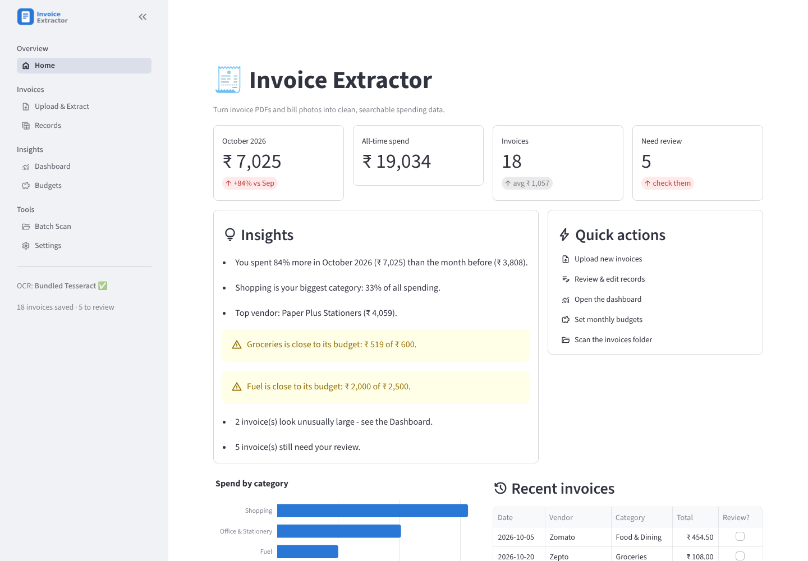
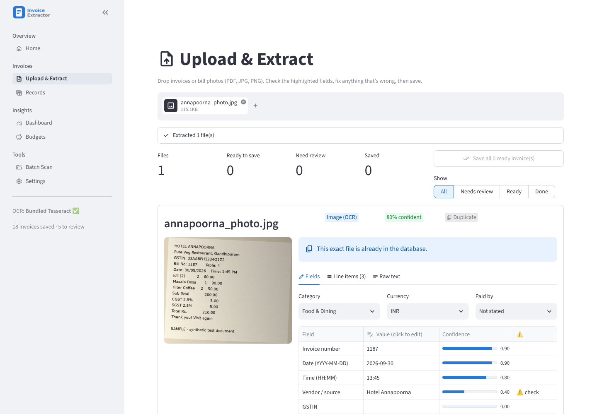
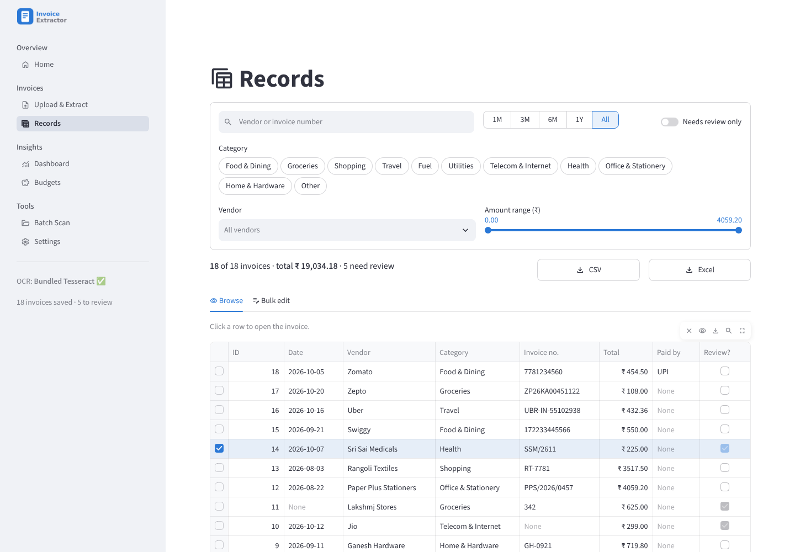
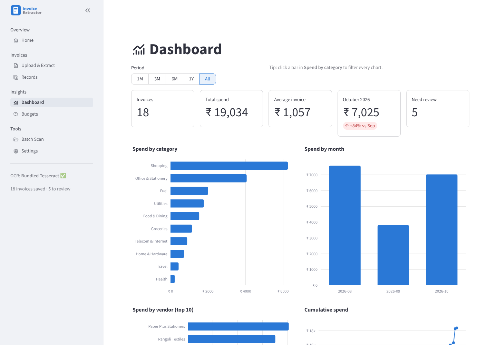
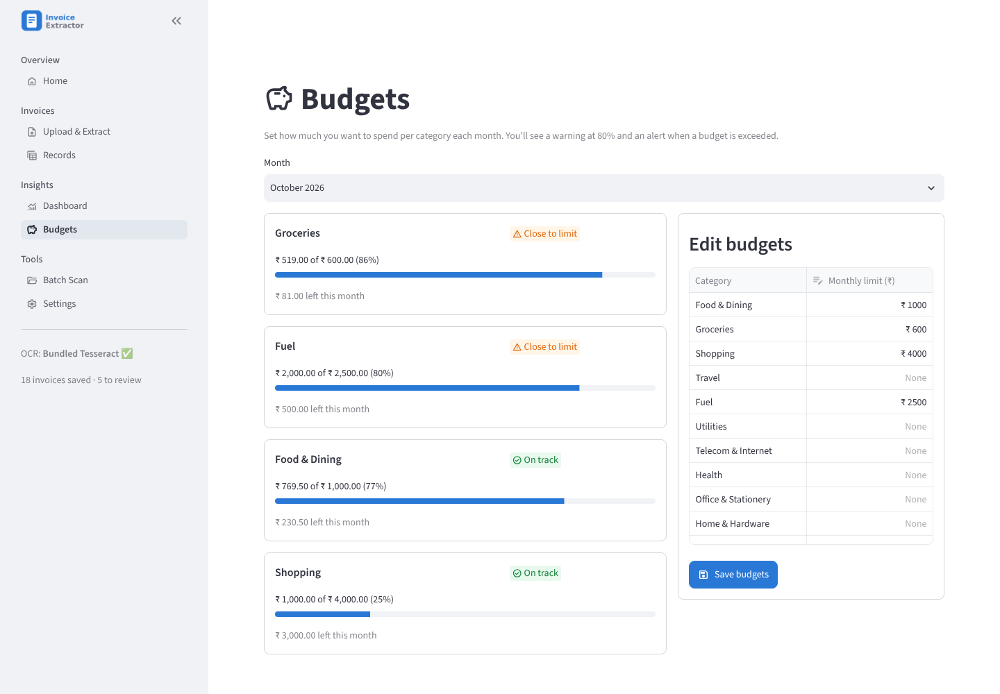
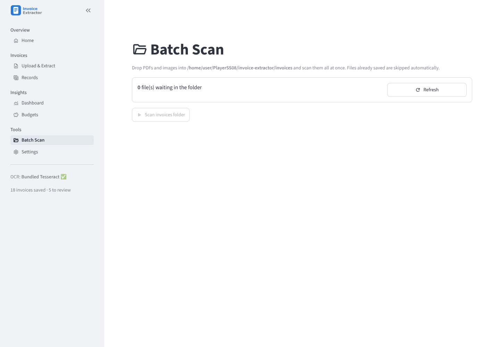
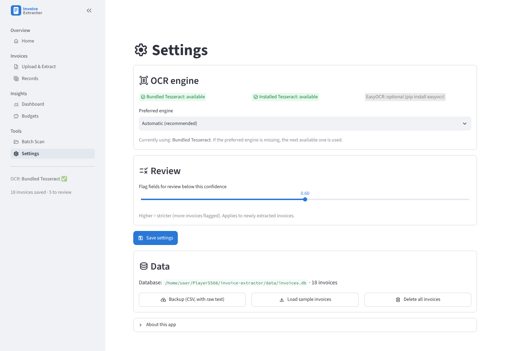
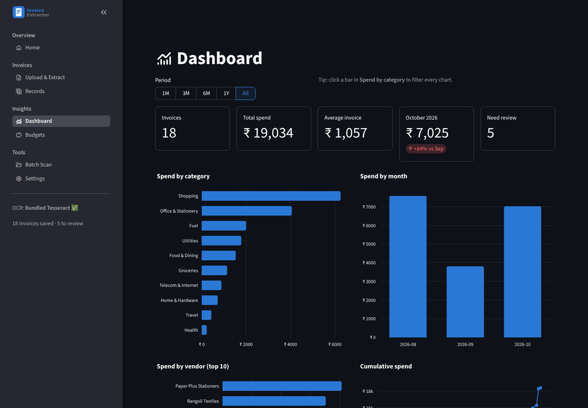

# 🧾 Invoice Extractor

A Python application that reads invoices and bills stored as **PDF files or images** and
automatically extracts the **date, time, vendor (source), invoice number and total amount**,
plus GST details, line items, expense category, currency, payment method and a confidence score
for every field. It handles digital PDFs, scanned PDFs and phone photos of bills (OCR with a
**bundled Tesseract engine**, so nothing extra has to be installed), validates GST arithmetic,
flags uncertain results for review, stores everything in **SQLite**, and gives you an interactive
multi-page app: an overview with insights, editable records, a dashboard with clickable charts,
monthly budgets with alerts, and a downloadable PDF report. The whole project is **Python only**:
the user interface is built with Streamlit, so there are no HTML, CSS or JavaScript files.

---

## 1. Problem statement

Businesses and individuals receive invoices and bills as scanned PDFs, photos and digital
documents, and entering their details by hand is slow and error-prone. This project builds a
Python application that accepts invoices in PDF or image format, extracts the invoice date,
time, vendor, invoice number and total amount using text extraction, OCR and rule-based
parsing, validates GST calculations, and stores the results in a SQLite database. Users can
review and correct low-confidence fields, export records to CSV or Excel, and view spending
summaries by vendor and month. The system reports its extraction accuracy on a test set of
invoices.

## 2. Features

**Extraction**
- **Upload many files at once** (PDF, JPG, JPEG, PNG) with live, per-file progress
- **Three extraction paths**: digital PDF text (`pymupdf`, with `pdfplumber` as backup) → scanned PDF
  (pages rendered at 300 DPI, then OCR) → images (OCR)
- **Bundled OCR**: Tesseract 5 ships inside the `tesserocr` pip package and the English model is in
  `tessdata/`, so OCR works right after `pip install`. An installed Tesseract (found automatically,
  even in `C:\Program Files\Tesseract-OCR` when it isn't on PATH) or EasyOCR can be used instead
- **Image cleaning before OCR**: grayscale, upscale, denoise, deskew, adaptive threshold; two page
  layouts (`psm 6` and `psm 4`) are tried and the more confident result is kept
- **Fields**: invoice number, date, time, vendor, GSTIN, subtotal, CGST, SGST, IGST, total,
  **line items** (item, qty, rate, amount), **expense category**, **currency** (₹ $ € £),
  **payment method** (UPI, Card, Cash, Net Banking, Wallet)
- **Indian formats**: day-first dates (`31/10/26`, `31-Oct-2026`, …), `₹ / Rs. / INR`, lakh grouping
  (`1,23,456.78`), `500/-`, common OCR mistakes (`O→0`, `l→1`, `S→5` inside numbers)
- **Confidence score per field** plus a weighted overall score; low-confidence fields get a ⚠️

**Checking and storage**
- **Validation**: GST arithmetic (±₹1), GSTIN structure + state code, sanity checks (total > 0 and
  < ₹1 crore, date not in the future) and an automatic **needs-review** flag
- **Duplicate detection**: the same file (SHA-256) is never imported twice; same vendor + invoice
  number gives a warning; the dashboard lists vendor + number + total matches
- **SQLite** database with automatic upgrade of older databases; a copy of every original file is
  kept so you can look at it again later

**Interactive app** (7 pages, light and dark mode)
- **Home**: month-on-month spend, insights in plain English, budget alerts, quick actions,
  recent invoices, one-click sample data
- **Upload & Extract**: confidence badges, editable fields, category/currency/payment pickers, line
  items and raw text tabs, "save all ready" and filter by status
- **Records**: search, period, category, vendor and amount filters; click a row to see the original
  file and edit it; delete with a confirmation dialog; bulk edit; CSV and Excel export
- **Dashboard**: 1M/3M/6M/1Y/All switch, **click a category bar to filter every chart**, spend by
  category, month, vendor, payment method, cumulative trend, GST donut, **unusual amounts**,
  **recurring vendors**, possible duplicates, and a **monthly PDF report**
- **Budgets**: monthly limit per category with progress bars, warnings at 80% and alerts when over
- **Batch Scan**: process the whole `invoices/` folder with a progress bar
- **Settings**: OCR engine status and choice, review threshold, backup, sample data, reset
- **Never crashes on a bad file**: unreadable files are saved with `needs_review` and a warning

## 3. Screenshots

| Page | Screenshot |
|---|---|
| Home |  |
| Upload & Extract |  |
| Records |  |
| Dashboard |  |
| Budgets |  |
| Batch Scan |  |
| Settings |  |
| Dark mode |  |

## 4. Architecture

```
            ┌──────────────┐     ┌───────────────────────────┐
 PDF/image ─▶ text_extraction│──▶ │ digital PDF? → pdf_text     │
            │ get_text()   │     │ scanned PDF  → ocr.py (300 DPI)
            └──────────────┘     │ image        → ocr.py       │
                   │              └───────────────────────────┘
                   ▼  raw text
            ┌──────────────┐   normalise text, one function per field
            │  parser.py   │──▶ fields.py  (number, date, time, vendor, total, GST,
            └──────────────┘               currency, payment, line items)
                   │                   categories.py (expense category)
                   │  InvoiceData (models.py)
                   ▼
            ┌──────────────┐   GST check, GSTIN check, sanity checks,
            │ validators.py│   confidence, needs_review
            └──────────────┘
                   │
                   ▼
   app.py + ui/ (Streamlit pages) ──▶ storage/db.py (SQLite: invoices, budgets, settings)
                                          │          └──▶ storage/export.py (CSV / Excel)
                                          └──▶ analytics/dashboard.py (insights, Plotly charts)
                                               analytics/report.py   (monthly PDF)
```

```
invoice-extractor/
├── app.py                      # Streamlit entry point: page setup + navigation
├── run.py / install.py         # one-command launch / install helpers
├── config.py                   # constants: paths, thresholds, OCR engine
├── ui/                         # one script per page + shared components
│   ├── home.py  upload.py  records.py  dashboard.py  budgets.py  batch.py  settings.py
│   └── components.py           # badges, previews, formatting, invoice detail
├── extractor/
│   ├── text_extraction.py      # get_text(file) -> (text, method), file hashing
│   ├── ocr.py                  # preprocess_image(), ocr_image(), engines, scanned PDFs
│   ├── parser.py               # parse_invoice(text) -> InvoiceData, process_file()
│   ├── fields.py               # one function per field (date, time, amount, vendor, items, ...)
│   ├── categories.py           # expense category tagging (+ categories.json)
│   ├── validators.py           # GST check, sanity checks, confidence scoring
│   ├── models.py               # InvoiceData dataclass
│   └── vendors.json            # known vendor names (easy to extend)
├── storage/
│   ├── db.py                   # SQLite: invoices, budgets, settings; filters; migrations
│   └── export.py               # to_csv(), to_excel()
├── analytics/
│   ├── dashboard.py            # spend by vendor/month/category, budgets, anomalies, insights
│   └── report.py               # monthly PDF summary
├── scripts/
│   ├── scan_folder.py          # batch CLI (descendant of the old Scanner.py)
│   └── evaluate.py             # accuracy report against tests/ground_truth.csv
├── tessdata/eng.traineddata    # bundled English model for Tesseract
├── tests/                      # pytest suite (250 tests)
│   ├── samples/                # 18 sample invoices + make_samples.py
│   └── ground_truth.csv        # expected values for each sample
├── assets/logo.png  .streamlit/config.toml  docs/screenshots/
├── data/                       # invoices.db + copies of saved files (gitignored)
├── invoices/                   # drop-in folder for batch scan (gitignored)
└── requirements.txt
```

### What happened to the original `Scanner.py`

Its logic was **moved and extended, not deleted**:

| Old `Scanner.py` | Now |
|---|---|
| Invoice-number regex | `extractor/fields.py` → `extract_invoice_number()` with more labels (Inv No, Bill No, Receipt No, Order ID, …) |
| `pymupdf` text reading | `extractor/text_extraction.py` → `pdf_text_pymupdf()` |
| `INSERT OR IGNORE` de-duplication | `storage/db.py` → `insert_invoice()`, now keyed on the **file hash** so two vendors can both have invoice `0001` |
| `date_added` (scan time) | renamed `scanned_at`; the date printed on the invoice is the new `invoice_date` |
| `Manager` database file | `data/invoices.db` |
| DB connection + folder creation at import time | `get_connection()` / `connect()` context manager, created only when needed |
| `print` instead of returning data | functions return data; printing only in the CLI script |
| "REVIEW" message & skip | file is **saved** and flagged `needs_review` |
| `scan_invoices()` / `show_database()` | `scripts/scan_folder.py` (PDFs **and** images) and the Batch Scan page |

## 5. Installation

Requires **Python 3.10+** (tested on 3.13) on Windows, macOS or Linux. On Windows tick
**"Add Python to PATH"** when installing Python.

Open a terminal in the `invoice-extractor` folder, then (recommended) create and activate a
virtual environment:

```bash
python -m venv .venv
```

Activate it with `.venv\Scripts\activate` (Windows) or `source .venv/bin/activate` (macOS/Linux).
Then install everything with one command:

```bash
python install.py
```

That's all — **OCR is included**. `install.py` installs `requirements.txt` (which contains
`tesserocr`, a package that ships the Tesseract 5 engine for Windows, macOS and Linux), uses the
offline wheels in `vendor/wheels/` if they are present (they are in the release zip), and checks
that OCR works. `pip install -r requirements.txt` does the same without the check.

**Optional — a full Tesseract program** (only if you prefer it over the bundled engine; choose it
in *Settings*):

| OS | Command |
|---|---|
| Windows | Installer from [UB Mannheim](https://github.com/UB-Mannheim/tesseract/wiki) (found automatically in `C:\Program Files\Tesseract-OCR`) |
| macOS | `brew install tesseract` |
| Linux (Debian/Ubuntu) | `sudo apt install tesseract-ocr` |

## 6. How to run

```bash
python run.py
```

(or `streamlit run app.py`). The browser opens at <http://localhost:8501>. On the Home page press
**Load sample invoices** to explore every feature with the 18 samples.

Batch scan from the command line (put files in `invoices/` first):

```bash
python scripts/scan_folder.py
```

Run the tests:

```bash
python -m pytest
```

Run the accuracy report (add `--details` to list every mismatch):

```bash
python scripts/evaluate.py
```

Regenerate the sample invoices and `ground_truth.csv`:

```bash
python tests/samples/make_samples.py
```

## 7. Accuracy results

Output of `python scripts/evaluate.py` on the 18 files in `tests/samples/` (bundled Tesseract 5.5):

| Field | Correct / Total | Accuracy |
|---|---|---|
| invoice_number (only where present) | 17 / 17 | 100.0% |
| invoice_date | 17 / 18 | 94.4% |
| invoice_time (only where present) | 8 / 8 | 100.0% |
| vendor | 17 / 18 | 94.4% |
| total_amount | 18 / 18 | 100.0% |

Matching rules: amounts within ₹0.01, dates/times compared as ISO strings, vendor matched
case-insensitively as a substring. Both misses are on the handwritten-style bill (OCR drops
the date line and reads "Lakshmi" as "Lakshmj"); that bill is correctly flagged *needs review*.

**Be honest about these numbers in the viva:** the current sample set is **synthetic**
(generated by `tests/samples/make_samples.py` with fictional names and numbers, no personal
data). It covers every type the spec asks for (Amazon/Flipkart-style invoices, Swiggy/Zomato
orders, electricity and phone bills, restaurant/café/fuel receipts, phone photos with tilt,
shadow and noise, scanned PDFs and a handwritten-style bill) but it is cleaner than real
documents. **Before the final presentation, add your own real invoices** to `tests/samples/`
(blur phone numbers, addresses and card digits first), add one row per file to
`tests/ground_truth.csv`, re-run `evaluate.py` and update this table.

## 8. Limitations and future work

- **Handwritten bills** are unreliable with Tesseract; a handwriting OCR model (e.g. TrOCR) would help.
- **English only**; Hindi/regional-language invoices need extra Tesseract language packs and keywords.
- **Rule-based parsing** depends on labels such as "Grand Total"; unusual layouts fall back to
  guesses (flagged for review). A layout-aware ML model (LayoutLM, Donut) could learn layouts.
- Marketplace invoices list the **seller** (e.g. "Sold By") as the vendor, not the marketplace.
- **Line items** are found with layout rules; complex multi-column tables (e.g. Amazon's tax
  table) may be skipped. Categories come from keyword lists in `categories.json`.
- Totals from tables without a summary line are guessed (and flagged). The currency is detected,
  but amounts are not converted, so dashboard totals assume everything is in ₹.
- Future: user login, multi-language OCR, learning categories from the user's corrections,
  e-mail import of invoices.

## 9. Team members and task allocation

*(Replace "Person 1–4" with your names. Everyone must have their own commits on GitHub.)*

| Member | Responsibility | Main files |
|---|---|---|
| Person 1 | PDF text extraction, batch script, file hashing | `text_extraction.py`, `scripts/scan_folder.py` |
| Person 2 | OCR, image preprocessing, bundled engine | `ocr.py`, `tessdata/` |
| Person 3 | Field parsing, categories, validators, tests, accuracy evaluation | `fields.py`, `categories.py`, `parser.py`, `validators.py`, `tests/`, `evaluate.py` |
| Person 4 | Streamlit UI, database, export, dashboard, budgets, report | `app.py`, `ui/`, `db.py`, `export.py`, `dashboard.py`, `report.py` |

## 10. Libraries used

| Purpose | Library |
|---|---|
| PDF text (digital PDFs) | `pymupdf`, `pdfplumber` |
| PDF pages to images (scanned PDFs) | `pymupdf` (`page.get_pixmap`), no Poppler needed |
| OCR | `tesserocr` (bundled Tesseract 5), `pytesseract` (installed Tesseract); optional `easyocr` |
| Image cleaning | `opencv-python-headless`, `Pillow`, `numpy` |
| Dates | `python-dateutil` + our own regex list |
| Database | `sqlite3` (standard library) |
| Tables and export | `pandas`, `openpyxl` |
| User interface | `streamlit` |
| Charts | `plotly` |
| PDF report | `pymupdf` |
| Tests | `pytest` |
